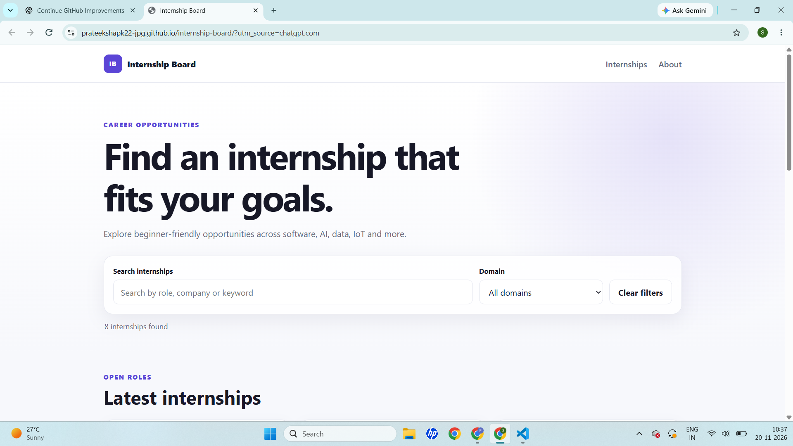
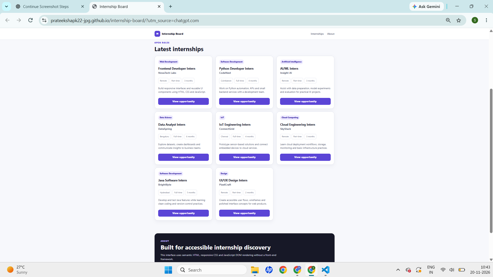
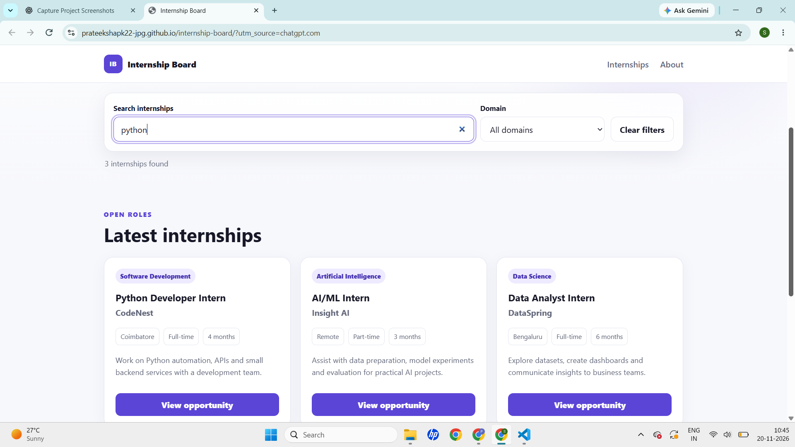
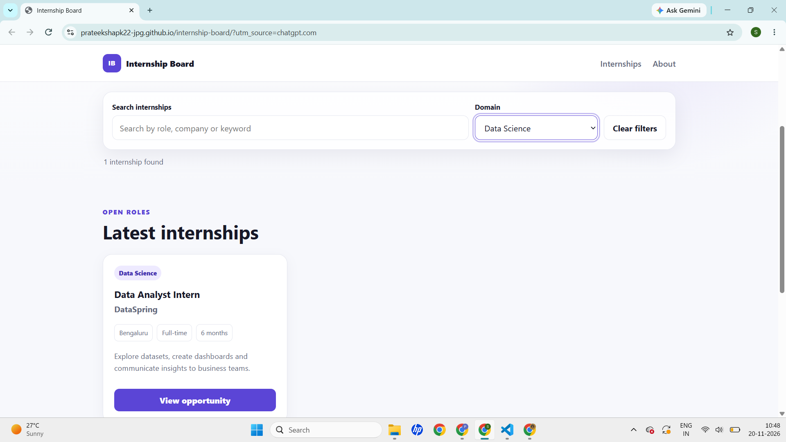

# Responsive Internship Board

A responsive, beginner-friendly Internship Board web application developed using **HTML5, CSS3, and Vanilla JavaScript**. The application displays internship opportunities dynamically and allows users to search and filter listings based on different criteria.

## Project Overview

The Responsive Internship Board provides a simple and user-friendly interface for exploring internship opportunities. Internship information is loaded dynamically from a JSON file and displayed as internship cards.

The project demonstrates frontend web development, responsive design, JavaScript DOM manipulation, JSON data handling, search functionality, and filtering.

## Technologies Used

- **HTML5** – Structure of the web application
- **CSS3** – Styling and responsive layouts
- **JavaScript** – Dynamic functionality and user interactions
- **JSON** – Internship data storage

## Features

### User Interface
- Responsive layout for desktop, tablet, and mobile devices
- Clean and user-friendly interface
- Dynamically generated internship cards
- Accessible labels and keyboard-friendly controls

### Search and Filtering
- Search internships by role
- Search by company name
- Search by location
- Search by domain, description, and tags
- Domain-based filtering
- Empty-result message with reset functionality

### Additional Features
- Dynamic JSON data loading
- Error handling when internship data cannot be loaded
- Retry functionality
- Visible keyboard focus states
- Live result updates
- No frontend framework required

## Project Structure

```text
internship-board/
│
├── data/
│   └── internships.json
│
├── screenshots/
│   ├── 01-homepage.png.png
│   ├── 02-internship-listings.png.png
│   ├── 03-search-functionality.png.png
│   └── 04-domain-filtering.png.png
│
├── index.html
├── styles.css
├── script.js
└── README.md
```

## Installation and Setup

### 1. Clone the Repository

```bash
git clone https://github.com/prateekshapk22-jpg/internship-board.git
```

### 2. Navigate to the Project Directory

```bash
cd internship-board
```

### 3. Open the Project

Open the project folder in Visual Studio Code.

### 4. Run the Application

Use the VS Code Live Server extension to launch the application.

Alternatively, run:

```bash
python -m http.server 5500
```

Open the following URL in your browser:

```text
http://localhost:5500
```

**Note:** A local web server is required because the application loads internship data using JavaScript `fetch()`.

## GitHub Pages Deployment

The project is hosted using GitHub Pages.

1. Open the repository on GitHub.
2. Navigate to Settings.
3. Select Pages.
4. Under Build and Deployment, choose Deploy from a branch.
5. Select the `main` branch.
6. Select the `/ (root)` folder.
7. Click Save.

**Live Website:** https://prateekshapk22-jpg.github.io/internship-board/

## Testing Checklist

- Internship cards load from the JSON file.
- Search functionality works correctly.
- Domain filtering works correctly.
- Empty-result state is displayed when no internships match.
- Reset functionality works.
- Error handling and retry functionality work.
- Responsive layouts are checked on different screen sizes.
- Keyboard navigation and visible focus states work.

## Project Screenshots

The following screenshots demonstrate the main features and functionality of the Responsive Internship Board.

### 1. Homepage



### 2. Internship Listings



### 3. Search Functionality



### 4. Domain Filtering



## Author

**Prateeksha Prabhu**

B.E. Computer Science and Engineering (IoT)

Sri Krishna College of Engineering and Technology
